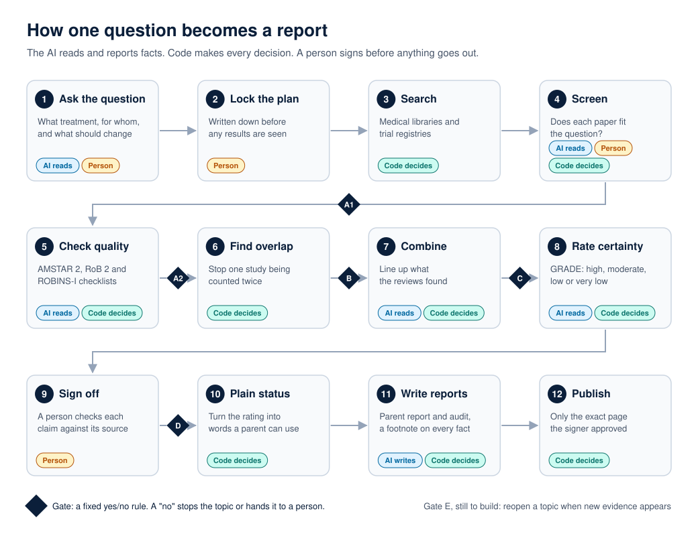

# Methods, step by step

This page says what each step does, who does it, and why it is there. It names the published
standards the engine follows. The exact rules inside the code stay private. For the bigger choices
behind the design, see [design-decisions.md](design-decisions.md).

## Who does what

- **AI reads.** The AI reads papers and answers fixed questions about them, quoting the paper.
- **Code decides.** Plain rules in code turn those answers into scores and yes/no decisions.
  The same answers always give the same result.
- **Person.** A named person confirms the question, settles disagreements, and signs at the end.

A **gate** is a fixed yes/no rule at the end of a step. A "no" stops the topic or hands it to a
person. Gates exist so that a weak step cannot quietly pass bad work to the next one.

---

### Step 1. Ask the question

**What happens.** The question is written in four parts, a format researchers call PICO: who it is
for, what treatment, compared with what, and what should change (for example, "time to fall
asleep"). The AI drafts it. A person confirms it.

**Why.** A vague question gets a vague answer. "Does melatonin work?" cannot be checked. "Does
melatonin shorten the time it takes autistic children to fall asleep, compared with a placebo?"
can.

**Gate.** A person must confirm the question, the outcomes that count, and the rules for which
papers get in.

### Step 2. Lock the plan

**What happens.** The plan is written down and prepared for a public register (PROSPERO or OSF)
before any results are looked at.

**Why.** If the question can change after the answers are seen, the answers can be made to say
anything. Locking it first is standard in medical research.

**Gate.** A person confirms the plan and records the registration.

### Step 3. Search

**What happens.** Code searches PubMed and other medical sources, plus ClinicalTrials.gov, using the
locked plan. It also checks which papers are free to read in full.

**Why.** A review is only as good as its search. Missing papers can change the answer. The search is
run by code so it can be repeated exactly.

### Step 4. Screen

**What happens.** Each paper is checked against the rules from step 1: does it fit the question? A
blind sample of 60 papers is rated by both the AI and a person, without seeing each other's answers.
Every disagreement is settled by a named person. Every paper that is dropped keeps the rule it
failed.

**Why.** Two independent readers catch each other's mistakes. This is the standard for systematic
reviews (PRISMA, Cochrane). How often they agree is reported, not used as a pass mark (see
[decision 8](design-decisions.md#8-report-how-often-readers-agree-do-not-use-it-as-a-pass-mark)).

**Gate A1.** Did at least one paper pass screening? If not, the topic stops here.

### Step 5. Check quality

**What happens.** Each paper is scored with the checklist made for its type:

- **AMSTAR 2** for systematic reviews (reviews of many studies)
- **RoB 2** for randomised trials
- **ROBINS-I** for studies that did not randomise

The AI answers each checklist question one at a time, with a quote from the paper. Code combines
the answers into a rating using the checklist's own rules. If the AI is not confident enough, the
question is held for a person.

**Why.** A badly run study can look convincing. These checklists are how researchers judge whether
a study can be trusted. Asking one question at a time, with a quote, makes every answer checkable.

**Gate A2.** Is there at least one real systematic review? A weak review still counts, but its low
rating travels with it.

### Step 6. Find overlap

**What happens.** Code checks whether different reviews are built on the same studies.

**Why.** If three reviews all include the same small trial, that trial is not three pieces of
evidence. Counting it three times would make the evidence look stronger than it is.

**Gate B.** For each outcome, how much do the reviews overlap? High overlap changes how they are
combined.

### Step 7. Combine

**What happens.** The AI reads what each review found for each outcome. Code lines the findings up
and checks where they agree and disagree.

**Why.** Reviews often disagree. Showing where and why is more useful to a family than one blended
answer.

**Gate C.** Do the strongest reviews agree? If not, the disagreement is shown, not hidden.

### Step 8. Rate certainty

**What happens.** For each outcome, the evidence is rated high, moderate, low or very low, using
**GRADE**. The AI answers fixed questions. Code applies the GRADE rules. For example:

- Results that point in opposite directions lower the rating.
- An outcome measured in only one study is not marked down for inconsistency.
- A harm is only reported when the results clearly rule out "no effect".

**Why.** "It worked in one study" and "it worked in twenty studies" are very different. GRADE is the
standard way to say how sure we can be.

### Step 9. Sign off

**What happens.** A person checks every claim against its source and signs. The signature is
recorded so it cannot be changed without leaving a trace.

**Why.** A person takes responsibility for what is published, as in any medical review. Today one
person signs. The standard asks for a second, independent reviewer, and every report says that one
is missing.

**Gate D.** Does the topic pass sign-off? If not, it goes back with reasons.

### Step 10. Plain status

**What happens.** Code turns the ratings into a plain status a parent can understand, such as
"promising but contested".

**Why.** "Low certainty, inconsistent direction" means little to most parents. A fixed table, not
the AI, picks the words, so the same evidence always gets the same status.

### Step 11. Write reports

**What happens.** Two documents are written:

- **A short report for parents**, in plain language.
- **A full audit document for experts**, showing every step, every paper and every decision.

Both have a footnote on every fact about the evidence. An "In depth" section, written by the AI from
papers that passed every check, explains the numbers and what the authors themselves concluded. Code
drops any sentence it cannot trace back to a paper.

**Why.** Parents need a clear answer. Doubters need to be able to check it. Two documents serve both.

### Step 12. Publish

**What happens.** Code publishes only the exact page the person signed.

**Why.** It stops a change from slipping in after the signature.

### Later: Gate E (planned, not built)

**What it will do.** Reopen a topic when a new review, a big new trial, a retraction, or 12 months
passing could change the answer.

**Why.** Evidence keeps changing. A report that is never updated slowly becomes wrong.

---

## Rules we hold to across every step

- **Nothing is thrown away.** A paper that is left out keeps its reason, so anyone can see why.
- **Agreement is reported, not used to hide disagreement.** A named person settles every
  disagreement, and how often readers agreed before discussing it is reported.
- **Flaws are written down.** Every known defect goes into a dated register.
- **One reviewer is said out loud.** Until a second independent reviewer joins, every report says
  on its front page that only one person signed it.
